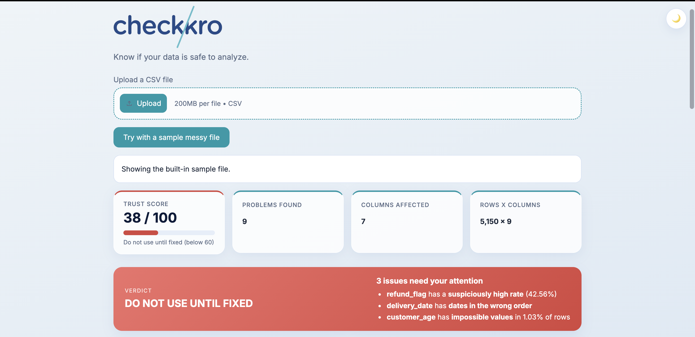
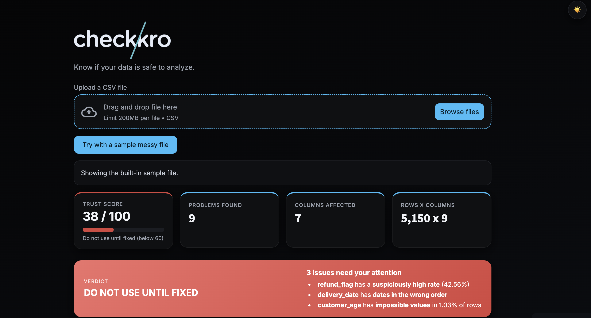
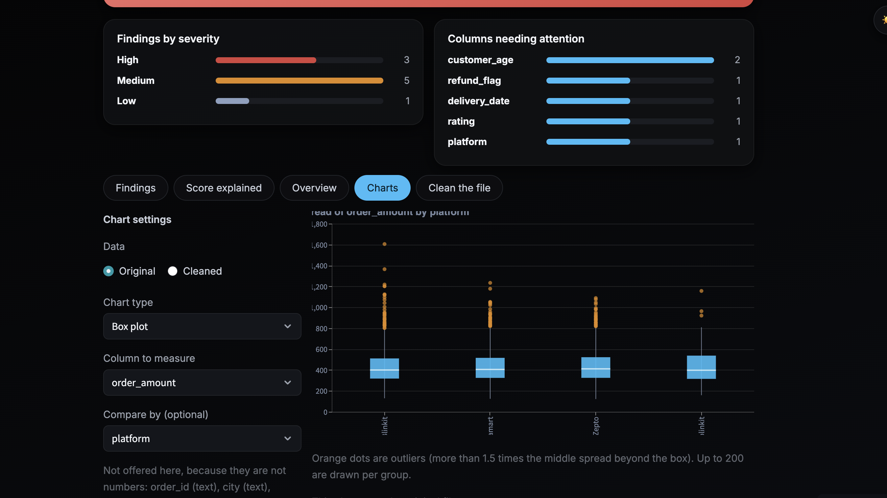

# 🛡️ CheckKro

### Know if your data is safe to analyze.

**CheckKro** is a rule-based CSV data quality analyzer that checks your data the way an analyst would when opening a file for the first time. It answers one simple question: **Can I trust this data?**

Get a trust score out of 100, understand what is wrong, see how issues affect your numbers, and clean your data safely — without silently changing your original file.

🚀 **Live Demo:** https://checkkro.streamlit.app/  
💻 **GitHub Repository:** https://github.com/disha-jais/CheckKro

---

## 📸 Screenshots

<p>
  
  
</p>

<p align="center">
  
</p>

---

## ✨ What Can CheckKro Do?

### 🔍 1. Detect Data Quality Issues
Runs **19 types of checks** to identify common data problems, including:

- Missing and hidden-missing values
- Duplicate rows and IDs
- Formatting inconsistencies
- Impossible values and extreme outliers
- Invalid dates
- Suspicious rates and more

### 🎯 2. Get a Clear Trust Score
Receive a score out of 100, a color-coded indicator 🟢🟡🔴, and a plain-English verdict that helps you understand whether your dataset is ready for analysis.

For example:

> ⚠️ 1 issue needs your attention: Vehicle Images has placeholder values in 100% of rows.

### 📊 3. Understand the Impact on Your Analysis
CheckKro goes beyond identifying problems. It explains how they can affect your results.

Instead of simply reporting *150 duplicate rows*, it might explain:

> 📉 Total order amount is overstated by 3.1%.

### 🧹 4. Clean Your Data Safely
Apply a limited set of transparent fixes:

- Trim unnecessary spaces
- Convert recognized placeholders such as `N/A` and `#NAME?` into missing values
- Remove exact duplicate rows

📝 Every change is recorded in a downloadable change log. Your original file remains unchanged.

### 📈 5. Explore Your Data with Interactive Charts
Create visualizations using the original or cleaned dataset.

**11 chart types supported:**
- Bar and stacked bar charts
- Line and area charts
- Pie and donut charts
- Scatter plots and histograms
- Box plots
- Correlation heatmaps
- Missing-values charts

📱 Works on desktop and mobile, with light and dark themes.

---

## 💡 What Makes CheckKro Different?

- 🎯 **Impact, not just detection:** Understand how data issues can distort analytical results.
- 🧠 **Context-aware missing-value checks:** Recognizes when blanks may be expected, such as ratings missing for cancelled rides.
- 🚨 **Suspicious-data detection:** Flags unusual rates, such as a refund rate of 42%, for further investigation.
- 🔒 **Transparent cleaning:** No silent changes; every applied fix is logged.
- 🐍 **Explainable, rule-based logic:** Built with Python rather than AI-generated judgments, making the checks repeatable and inspectable.

---

## 🧮 How Does the Trust Score Work?

Every dataset starts with a score of **100**.

| Finding severity | Points deducted |
|---|---:|
| 🔴 High | 12 |
| 🟡 Medium | 5 |
| 🟢 Low | 1 |

### 📋 Verdicts

| Score | Verdict |
|---|---|
| 85–100, with no high-severity findings | ✅ Safe to analyze |
| 60–84, or 85+ with a high-severity finding | ⚠️ Use with caution |
| Below 60 | ⛔ Do not use until fixed |

*The score is a heuristic, not a statistical probability. Open the **Score Explained** tab in the app to see how the results were calculated.*

---

## 🧪 How Well Does It Work?

### ✅ Planted-Error Test

I introduced **17 types of known errors** individually across three synthetic datasets of different sizes.

- 🧪 51 tests performed
- 🎯 51 out of 51 planted errors detected
- ✅ Zero serious false alarms on the clean test datasets

These tests demonstrate that the implemented checks detect the specific errors they were designed to identify. They do not establish performance on every real-world dataset.

### 🔬 Real-World Dataset Test

I also tested CheckKro on a real dataset containing **103,024 ride bookings**.

The initial version scored the dataset 0/100 and raised nine high-severity alarms. Most were false alarms caused by legitimate data patterns:

- 🚕 Ratings and payment details were blank for cancelled rides by design.
- 👥 Customer IDs repeated because customers could book multiple rides.
- ⚠️ A column containing Excel `#NAME?` errors was the actual data quality issue, but it was under-reported.

After refining the checks to address these problems, I reran the planted-error tests to verify that the changes did not break existing functionality.

**Final result:** The dataset scored 72/100, with one high-severity finding identifying the `#NAME?` column.

This testing process helped improve the balance between detecting genuine problems and avoiding misleading alerts.

---

## ⚠️ Known Limitations

- 📉 **Outliers:** A simple statistical rule can flag legitimate values in naturally skewed datasets.
- 🏷️ **Column names:** Some checks rely on English column names, such as `amount` or `age`.
- 📏 **Thresholds:** Defaults, such as a refund rate above 25%, may not suit every business.
- 🧾 **CSV parsing:** Pandas interprets values such as `N/A`, `NA`, `null`, and `None` as missing values when reading a CSV. Other placeholders, such as `-`, `?`, `unknown`, and `#NAME?`, can be detected as text.
- 📂 **File format:** Currently supports CSV files only.
- 🔐 **Privacy:** The public demo processes uploaded files in memory for the session and does not save them through the app. Avoid uploading confidential data; use the local version instead.

---

## 🚀 Run CheckKro Locally

Want to try it on your own machine?

**1. Clone the repository**

```bash
git clone https://github.com/disha-jais/CheckKro.git
cd CheckKro
```

**2. Install dependencies**

```bash
pip install -r requirements.txt
```

**3. Launch the application**

```bash
streamlit run app.py
```

💡 **New here?** Click **“Try with a sample messy file”** to explore CheckKro without uploading your own dataset.

---

## 🗂️ Project Structure

| File | Purpose |
|---|---|
| `app.py` | Streamlit dashboard, tabs, and themes |
| `checks.py` | Data quality checks and `run_checkup` |
| `scoring.py` | Trust score and verdict calculation |
| `cleaner.py` | Safe cleaning operations and change logs |
| `impact.py` | Plain-language explanations of analytical impact |
| `charts.py` | Eleven chart types |
| `datagen.py` | Clean and messy test data generation |
| `evaluate.py` | Error injection and detection evaluation |
| `BuildIt.ipynb` | Step-by-step project development notebook |

---

## 🛠️ Tech Stack

🐍 **Python** · 🐼 **Pandas** · 🔢 **NumPy** · 🎈 **Streamlit** · 📊 **Altair**

---

## 👩‍💻 About the Author

**Disha Jaiswal | Data Analyst**

I built CheckKro to explore a practical question in data analytics: how can we identify data quality issues before they affect business reporting and decision-making?

The project combines data validation, statistical checks, impact analysis, transparent data cleaning, and interactive visualization in one application.

🔗 [GitHub Profile](https://github.com/disha-jais)  
🚀 [Try CheckKro Live](https://checkkro.streamlit.app/)

---

⭐ **If you find CheckKro useful, consider giving the repository a star!**
